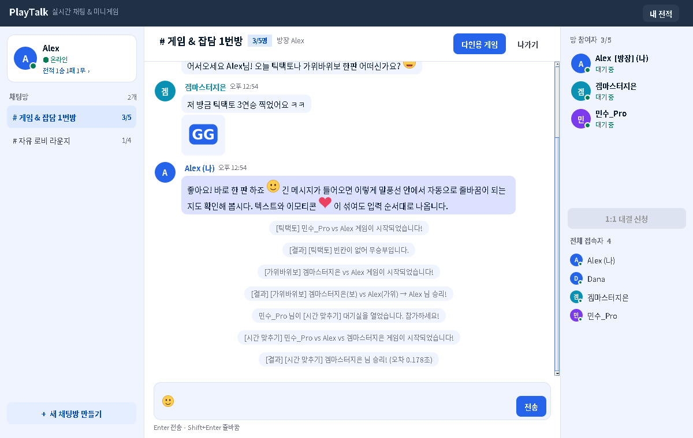
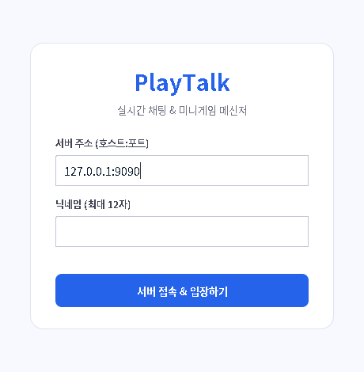
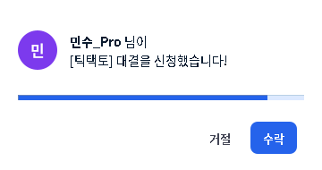
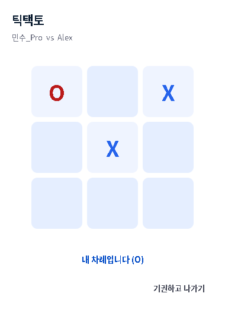
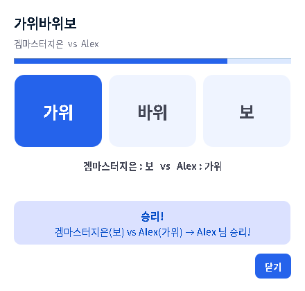
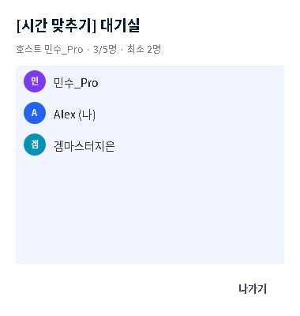
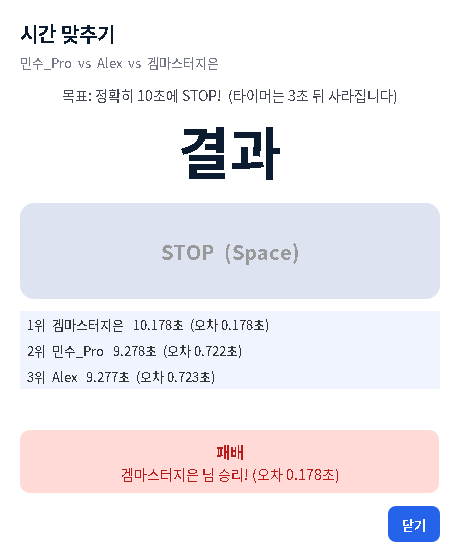
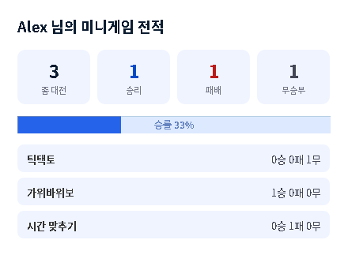

# PlayTalk

> 실시간 다인용 채팅과 미니게임을 함께 즐기는 Java 소켓 메신저
> 네트워크 프로그래밍[B] 텀프로젝트 · 팀원: 심유진, 신지현



| 개발 언어 | GUI | 통신 | 동시 처리 | 데이터 저장 |
|---|---|---|---|---|
| Java 17+ | Swing | TCP `Socket` / `ServerSocket` | 클라이언트별 스레드 + 동기화 | 서버 측 파일(CSV) |

외부 라이브러리 없이 JDK만으로 동작합니다.

---

## 실행 방법

### IntelliJ IDEA (추천)
1. `File > Open`에서 이 폴더를 엽니다. Maven 프로젝트로 인식됩니다.
2. `src/main/java/playtalk/server/ServerMain.java`를 실행합니다. 서버는 기본 포트 **9090**에서 시작합니다.
3. `src/main/java/playtalk/client/ClientMain.java`를 실행합니다. 여러 번 실행하면 여러 사용자로 테스트할 수 있습니다.
   - 클라이언트를 여러 개 띄우려면 `Run > Edit Configurations > Modify options > Allow multiple instances`를 체크합니다.

### 스크립트 (IDE 없이)
| | Windows | macOS / Linux |
|---|---|---|
| 서버 | `run-server.bat [포트]` | `./run-server.sh [포트]` |
| 클라이언트 | `run-client.bat` | `./run-client.sh` |

다른 컴퓨터에서 접속할 때는 로그인 화면의 서버 주소에 서버 PC의 IP를 입력합니다(예: `192.168.0.12:9090`). 서버 PC 방화벽에서 해당 포트를 열어 두어야 합니다.

### 서버 테스트
```bash
javac -encoding UTF-8 -d out/classes $(find src/main/java -name '*.java')
javac -encoding UTF-8 -d out/test -cp out/classes src/test/java/playtalk/ServerSmokeTest.java
java -cp out/classes:out/test playtalk.ServerSmokeTest      # Windows는 ':' 대신 ';'
```
가짜 클라이언트 5명으로 로그인부터 게임, 연결 끊김까지 31개 항목을 검사합니다. 서버 코드를 고친 뒤 push 전에 돌려 주세요.

---

## 기능 구현 현황

### 필수 기능
- [x] 닉네임 접속, 중복 닉네임 거부, 접속 종료 시 닉네임 반납
- [x] 전체 접속자 목록 실시간 반영
- [x] 실시간 채팅 (같은 방에만 전달)
- [x] 다중 채팅방: 생성(최대 인원 2~5명), 입장, 퇴장, 방 이동, 인원 초과 시 입장 제한
- [x] 방장: 방을 만든 사람. 방장이 나가면 다음 사람에게 넘어가고, 빈 방은 자동 삭제
- [x] 이모티콘: 이미지 이모티콘, 텍스트와 섞어서 한 말풍선에 입력 순서대로 표시
- [x] 1:1 게임 초대: 상대 선택, 수락/거절, 15초 응답 제한, 게임 중이거나 초대 대기 중이면 중복 신청 불가
- [x] 틱택토: 서버가 턴, 좌표 유효성, 승리·무승부 판정
- [x] 가위바위보: 두 사람이 모두 고르면 서버가 판정 (10초 제한)
- [x] **다인용 게임: 시간 맞추기 (2~5명)**, 채팅방 단위 대기실
- [x] 게임 중 상대가 나가거나 연결이 끊기면 감지해서 기권 처리

### 추가 기능
- [x] 게임 전적: 승/패/무, 승률, 게임별 기록. 서버를 다시 켜도 유지(`data/stats.csv`)
- [ ] 재대결
- [ ] 채팅 기록 저장 및 재입장 시 불러오기 선택
- [ ] 다인용 게임 추가 (폭탄 돌리기, 끝말잇기)
- [ ] 랭킹 / 게임 중 채팅 / 관전 / 방 비밀번호

<details>
<summary>화면 더 보기</summary>

| 로그인 | 게임 초대 | 틱택토 |
|---|---|---|
|  |  |  |

| 가위바위보 | 다인용 대기실 | 시간 맞추기 결과 | 전적 |
|---|---|---|---|
|  |  |  |  |

</details>

---

## 프로젝트 구조

```
src/main/java/playtalk/
├── common/                  서버·클라이언트 공용
│   ├── Message              메시지 1건 (한 줄 텍스트로 직렬화)
│   ├── MessageType          메시지 종류 (프로토콜 목록)
│   ├── GameType             게임 목록 (이름, 최소/최대 인원)
│   ├── Protocol             포트, 인원 제한 등 상수
│   └── Emoticons            이모티콘 코드 (:smile: 등)
│
├── server/
│   ├── ServerMain           실행 진입점
│   ├── PlayTalkServer       accept 루프, 매니저 연결, 로그인/접속 종료
│   ├── ClientHandler        클라이언트 1명 = 스레드 1개 (수신 루프, 동기화된 송신)
│   ├── MessageRouter        메시지 타입 → 처리 함수
│   ├── UserManager          접속자, 닉네임 중복 검사
│   ├── room/                ChatRoom, RoomManager (방 생성·입장·퇴장·채팅)
│   ├── game/                GameManager (초대·대기실·세션), GameSession (게임 공통 틀)
│   │   └── games/           TicTacToeGame, RockPaperScissorsGame, TimingGame
│   └── stats/               StatsStore (전적 파일 저장)
│
└── client/
    ├── ClientMain           실행 진입점
    ├── net/ServerConnection 소켓 수신 스레드 → Swing 스레드로 메시지 전달
    ├── ui/                  LoginDialog, MainFrame(3단), RoomListPanel, ChatPanel, MemberPanel,
    │                        CreateRoomDialog, StatsDialog, Theme(색·글꼴), components/
    └── game/                GameController (초대·대기실·게임 창 관리), GameWindow (게임 창 공통 틀)
        └── games/           TicTacToeWindow, RpsWindow, TimingWindow
```

## 구조 설명

```
 [Client]                                          [Server]
 Swing 화면 ◀─ EDT ─ 수신 스레드 ◀── TCP ──  ClientHandler 스레드 (1명당 1개)
     │                                              │ MessageRouter
     └──── ServerConnection.send() ───── TCP ──▶    ├─ RoomManager  (채팅방·채팅)
                                                    ├─ GameManager  (초대·대기실·게임 세션·타이머)
                                                    └─ StatsStore   (전적 파일)
```

- **프로토콜**: 메시지 한 건 = 한 줄. `TYPE\tkey=value\tkey=value`. 자세한 내용은 [docs/PROTOCOL.md](docs/PROTOCOL.md)
- **서버 권한(Server-authoritative)**: 턴, 좌표 검사, 승패 판정, 시간 측정은 모두 서버가 합니다. 클라이언트는 입력을 보내고 받은 상태를 그리기만 합니다.
- **동시성**
  - 클라이언트마다 수신 스레드 1개. 송신은 `synchronized`로 여러 스레드에서 안전하게 호출
  - 채팅방 상태는 `RoomManager`가, 게임 상태는 `GameManager`가 각자 잠금으로 보호
  - 잠금 순서 규칙: `RoomManager` 잠금 안에서는 `GameManager`를 호출하지 않음 (교착 상태 방지)
  - 게임 타이머(초대 만료, 가위바위보 제한 시간, 시간 맞추기)는 `ScheduledExecutorService` 하나에서 실행
- **클라이언트**: 수신 스레드가 `SwingUtilities.invokeLater`로 리스너를 호출하므로 리스너 안에서 바로 화면을 고쳐도 안전합니다.

## 새 게임 추가하기 (예: 폭탄 돌리기)

게임은 인원 수와 상관없이 같은 틀(`GameSession` / `GameWindow`)을 씁니다. 파일 2개를 만들고 3군데에 한 줄씩 추가하면 됩니다.

1. **`common/GameType`**에 상수 추가
   ```java
   BOMB("폭탄 돌리기", 3, 5),   // 최대 인원이 2보다 크면 자동으로 대기실 방식
   ```
2. **서버** `server/game/games/BombGame.java`: `GameSession` 상속
   ```java
   public class BombGame extends GameSession {
       public BombGame(String id, List<Participant> players, GameContext ctx) { super(id, GameType.BOMB, players, ctx); }
       @Override public void start() { /* 첫 턴, schedule(this::explode, 랜덤 ms) */ }
       @Override public void onAction(Participant from, Message action) { /* 폭탄 넘기기 */ }
   }
   ```
   그리고 `GameRegistry` 생성자에 `register(GameType.BOMB, BombGame::new);` 추가
3. **클라이언트** `client/game/games/BombWindow.java`: `GameWindow` 상속 (`onStart`, `onState` 구현)
   그리고 `GameWindowRegistry`에 `FACTORIES.put(GameType.BOMB, BombWindow::new);` 추가

초대, 대기실, 게임 시작/종료, 기권, 연결 끊김, 전적 기록은 공통 코드가 처리합니다.

## 디자인 변경 시

색과 글꼴은 `client/ui/Theme.java`에 모여 있습니다(Stitch 프로토타입 기준). Figma나 Stitch 디자인이 바뀌면 이 파일부터 수정하세요.

## 협업 규칙

- `main`은 항상 실행되는 상태로 유지합니다.
- 작업은 `feature/기능이름` 브랜치에서 하고 Pull Request로 합칩니다.
- 프로토콜(메시지 종류, key)을 바꾸면 `docs/PROTOCOL.md`도 함께 수정합니다.
- 제안서와 달라진 점은 [docs/CHANGES.md](docs/CHANGES.md)에 기록합니다(최종 보고서 작성용).
